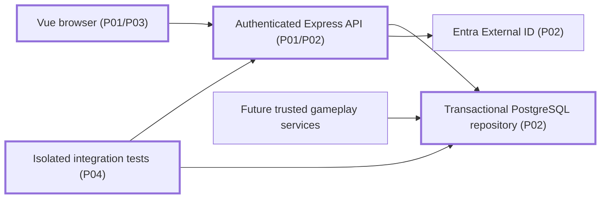

<!-- markdownlint-disable-file -->
# RPI Plan: Player Platform

## Task Metadata

Task ID: player-platform. Date: 2026-11-03. Participation: agent-owned, automatic through Review.

## Executive Summary

Build the selected Vue/TypeScript/Express/PostgreSQL core, with fail-closed authentication, account-scoped persistence, recoverable snapshots and server-only gameplay writes. No gameplay engines or deployment.

### What You May Not Know

The local environment lacks PostgreSQL server binaries. Production tenant configuration and jurisdiction-specific review remain external gates; do not claim #23 is fully closed.

## Phase Checklist

### Before

Design documents only; no application connections exist.

### After

<!-- rpi:phase id=P01 -->
### [x] P01: Establish typed application structure

Goals: reproducible workspace with shared runtime contracts.

Dependencies: none.

Changes in the map: Web, API.

<!-- rpi:task id=P01-T01 -->
#### [x] P01-T01: Create build and contract foundation

Goals: browser and server share validated read contracts, not server authority.

Requirements: FR-001, NFR-001.

Details: npm workspace, Vue/Vite, strict TypeScript, Zod schemas, explicit production/development entrypoints. No existing source or tests to remove. Canonical sources in apps and packages; generated build output ignored.

References: [docs/gdd.md](../../../docs/gdd.md), Browser delivery and persistence; prior stack in [.azure/requirements.json](../../../.azure/requirements.json).

Dependencies: none.

<!-- rpi:phase id=P02 -->
### [x] P02: Establish authoritative API and persistence

Goals: private state remains durable, owned, transactionally consistent and inaccessible to client fabrication.

Dependencies: P01.

Changes in the map: API, Store, Identity.

<!-- rpi:task id=P02-T01 -->
#### [x] P02-T01: Implement persistence and trust boundary

Goals: typed, account-scoped storage preserves every required record family with atomic writes and retry safety.

Requirements: FR-002, FR-003, FR-004, NFR-002.

Details: versioned SQL migrations; identity issuer/subject mapping, progression, facilities, purchases, immutable battles/events, reward counters/reservations, idempotent management ledger. Row locks and sorted participant locking protect concurrent state. Server-only APIs accept full records; HTTP accepts only profile intent and deletion confirmation. SSE reads durable revisions and snapshots; disconnect never invokes simulation or rewards. Account-linked deletion cascades through shared battles and derived records. A one-way issuer/subject fingerprint prevents automatic recreation; retain no raw identity or account ID in that tombstone. Disclose pseudonymous retention and its review gate, not complete identity erasure.

References: [docs/gdd.md](../../../docs/gdd.md), persistent records and disconnections; issues #23-27.

Dependencies: P01-T01.

<!-- rpi:phase id=P03 -->
### [x] P03: Connect minimal player interface

Goals: real sign-in, progress display and recovery never pretend local data is authoritative.

Dependencies: P02.

Changes in the map: Web.

<!-- rpi:task id=P03-T01 -->
#### [x] P03-T01: Implement account and recovery UI

Goals: users can sign in/out, inspect durable state, edit display name, recover connectivity and delete application data.

Requirements: FR-001, FR-004, FR-005, NFR-003.

Details: MSAL redirect-based SPA login; local-only simulated credentials on a dedicated local entrypoint. Clearly labeled connection errors, stale-save errors and deletion boundary. No local progress cache. Abort obsolete streams on sign-out/account switch.

References: [docs/gdd.md](../../../docs/gdd.md), Screens and user experience; issue #24.

Dependencies: P02-T01.

<!-- rpi:phase id=P04 -->
### [x] P04: Verify and document core platform

Goals: measured evidence supports local platform behavior without claiming production readiness.

Dependencies: P02, P03.

Changes in the map: Tests.

<!-- rpi:task id=P04-T01 -->
#### [x] P04-T01: Validate platform and document operation

Goals: restart durability, identity isolation, cross-account denial, stale actions, rollback and duplicate retries are reproducibly verified.

Requirements: FR-002 through FR-005, NFR-001 through NFR-003.

Details: add at most three test suites (contracts/auth, PostgreSQL/API, browser); no tests removed. Exercise real isolated PostgreSQL with schema separation, local JWT issuer/JWKS for production validation, and server-authored fixtures only. Commands: `npm test`, `npm run typecheck`, `npm run build`; browser verification against live API. Tests own semantic behavior and negative regressions, not snapshots of source text. README and platform documentation record commands and remaining acceptance gaps.

References: [.copilot-tracking/research/2026-11-03/player-platform-research.md](../../research/2026-11-03/player-platform-research.md).

Dependencies: P02-T01, P03-T01.

## User Decisions and Requirements

Confirmed: Vue/Vite, TypeScript/Express, PostgreSQL; build core platform; end-to-end mode. Preserve existing dirty documents.

| Group | Status | Owner | Decision or feedback item |
|---|---|---|---|
| D1 | Resolved | Agent | Local platform first; no deployment. Existing requirements explicitly defer tenant/cost/legal details. |
| D2 | Resolved | Agent | Revision-based authenticated SSE with snapshot refresh avoids another infrastructure dependency. |
| D3 | Deferred | User | Existing Entra registrations and production origins needed for live sign-in verification. |

## Planning Readiness and Next Step

Ready for local core implementation. Standard critique Complete, Revise with PC-001 resolved by planner correction. Automatic parent proceeds to Implement.

## Goals

Establish extensible persistence and ownership without implementing later gameplay.

## Scope and Non-Goals

Local core application only. No combat, economy balancing, matchmaking engine, art, hosted resources, issue closure, commit or push.

## Functional Requirements

* FR-001: Vue browser and Express API use shared TypeScript/runtime contracts.
* FR-002: Persist all account, animal, economy, facility, battle, reward and management-ledger record families from #25.
* FR-003: Validate Entra issuer/audience/signature/scope; stable identity mapping; local simulation cannot enter production build or data; HTTP never accepts authoritative game-state values.
* FR-004: Account-scoped reads/writes; explicit failures; reconnect reads stored snapshots without rewards/simulation; atomic idempotent trusted writes.
* FR-005: Verified application-data deletion removes account-linked records; document identity-provider and backup/legal boundaries.

## Non-Functional Requirements

* NFR-001: Strict typecheck, reproducible build and runtime schemas; no silent success fallback.
* NFR-002: Real PostgreSQL tests, atomic migrations, transaction rollback, deterministic lock order; no sensitive logs.
* NFR-003: Keyboard-operable UI with readable status and errors; no local progress cache.

## Risks and Open Questions

| Risk | Affected task | Resolution |
|---|---|---|
| Missing PostgreSQL server tools | P04-T01 | Restore missing tools or use explicitly isolated test database. |
| Unknown Entra registrations | P02-T01 | Fail closed; test cryptography locally, defer real-tenant verification. |
| Public legal/backup requirements unknown | P04-T01 | Document gate; do not claim legal approval or backup erasure. |

## Sources

GDD, .azure/requirements.json, issues #23-27 and current research. No BRD/PRD/ADR exists in the source snapshot.

## Critique Disposition

Standard, first-task default. Complete, Revise. PC-001 (Medium) resolved: pseudonymous fingerprint contract and documentation requirement added to P02. No open blocking findings. No additional critique required.

## Artifact Self-Check

Requirements mapped to tasks; no existing test removals; maximum three test suites; generated targets ignored.

## Follow-Up Items

Live Entra verification, hosting cost review and jurisdiction/backup policy are excluded readiness work, not invented local implementation blockers.

## Handoff

Implementation changes record: `.copilot-tracking/changes/2026-11-03/player-platform-changes.md`.
