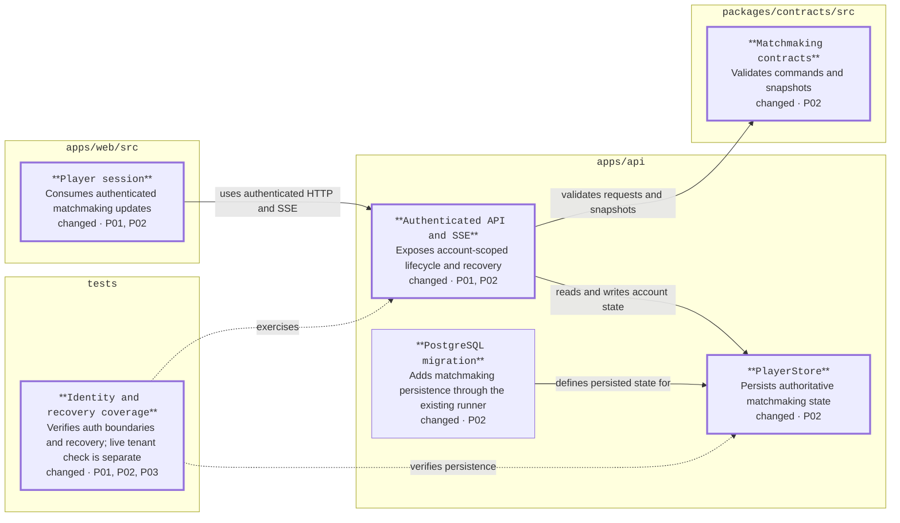

<!-- markdownlint-disable-file -->
# RPI Plan: Remaining P1 Platform Delivery

## Task Metadata

* Task ID: p1-platform-delivery
* Task slug: p1-platform-delivery
* Plan date: 2026-11-04

## Executive Summary

* Bottom line: Plan the remaining active P1 work for Entra sign-in (#24) and matchmaking-state synchronization/recovery (#26), building on the existing Vue, Express, and PostgreSQL platform.
* Why this matters: Complete the verified identity and reconnect behavior that the platform foundation intentionally left for later without expanding into the full game loop.
* Planning result: Ready for implementation after the initial standard critique; all nine findings are disposed. #27 privacy, retention, backup, and deletion-policy work remains deferred, with only the user-approved cleanup of new #26 matchmaking rows in scope.
* Confidence and uncertainty: High confidence in the repository and issue inventory; the confirmed Entra test configuration must be identified before live sign-in validation. Hosting cost is not validated.

### What You May Not Know

* Issue #23 is now closed. Issue #25 remains open and was reviewed separately; this plan focuses on #24 and #26, with only the minimum #25 overlap needed for #26 and no claim that #25 is complete.
* GitHub issue #38 is closed with Azure and a proposed $50/month ceiling recorded as review inputs, not an approved or validated budget. The project still has no gameplay engine or matchmaking implementation.
* The platform already has Entra/MSAL wiring, authenticated account snapshots, and recovery over SSE. Real-tenant sign-in and transient matchmaking events have not been verified.
* The user deferred #27 privacy and deletion-policy work until backup policy is available. The only approved deletion behavior here is cleanup of new #26 matchmaking records through existing account deletion.
* Do not inspect, display, or record `.env` values. The user authorized loading `.env` only as process environment for the live check; credentials and tokens must not be exposed.

## Phase Checklist

### After

Key: thicker borders mark changed components; phase tags identify the work. The browser uses the existing authenticated API/SSE path; the API validates the new matchmaking contracts and persists server-owned state. Automated tests verify identity boundaries and lifecycle/recovery behavior; the live tenant check is interactive and recorded separately without claiming the full matchmaking or combat loop.

<!-- rpi:phase id=P01 -->
### [x] P01: Verify live Entra sign-in

Goals:
* Validate interactive test-tenant sign-in and saved-account recovery, recorded separately from automated test results, while preserving the explicit production boundary around local simulated identity.

Dependencies:
* User-confirmed Entra External ID test tenant and interactive browser access; identify non-secret registration configuration before testing.

Changes in the map: Authenticated API and browser identity behavior; identity tests.

<!-- rpi:task id=P01-T01 -->
#### [x] P01-T01: Verify and close gaps in Entra account sign-in

Goals:
* A player can sign in to the configured Entra External ID tenant, access only the identity-bound account, and recover the same saved progress after sign-out and sign-in.

Requirements:
* FR-001, FR-002, NFR-001, NFR-003.
* Production rejects simulated identities; the authenticated identity is available to authorize private account, queue, battle, and management operations; sign-in or progress-load failures remain visible and never fall back to local progress.

Details:
* Use the confirmed test tenant and interactive sign-in. The user supplied Entra settings through `.env` and authorized loading them only as process environment; do not inspect, display, or record values, or copy tokens, secrets, or credentials into tracking, logs, test fixtures, or chat.
* The user approved adding opt-in Entra verification to the loopback-only development API. Preserve local simulated sign-in as the default. Entra mode must require explicit `LOCAL_AUTH_ENABLED=false`, the existing Entra issuer/audience/JWKS/scope settings, and the same loopback-only dedicated `_dev` database checks. It must not be available in the production bundle as simulated identity, weaken production configuration, or bind outside loopback.
* `VITE_ENTRA_AUTHORITY` must be tenant-scoped, include the tenant ID path, and end before `/v2.0`; its `v2.0/.well-known/openid-configuration` metadata must match `ENTRA_ISSUER`.
* Open the local SPA at `http://localhost:5173` because MSAL uses `window.location.origin` as the redirect URI and the registered Entra URI must match exactly. Keep the API loopback-only.
* Register that redirect under the browser client's Single-page application platform, not Web, and ensure `VITE_ENTRA_CLIENT_ID` selects that registration. The earlier `AADSTS9002326` was cleared by a fresh sign-in after registration guidance. Preserve authorization code with PKCE without adding a client secret or enabling implicit grants.
* Run the live browser check against the user-confirmed dedicated disposable non-production database and a dedicated test identity, never shared or production player data. Use the dev API in explicit Entra mode and Vite's existing `.env` settings; do not deploy or start a production instance. Verify interactively in the browser: sign in, verify the test identity's saved progress, sign out, sign in again, and verify the same progress is recovered. Remove only the test account and its test progress through the existing account-deletion flow after evidence capture. Record the date, pass/fail outcome, and non-sensitive evidence pointer in the changes record, separate from CI results; do not record tenant IDs, account identifiers, tokens, or other credentials.
* Existing production code validates signed JWTs and the browser has MSAL redirect wiring. Fix only verifiable gaps revealed by the live flow; if tenant configuration or access is unavailable, stop and record the precise missing prerequisite rather than substituting local JWT tests.
* Add configuration tests proving default local simulation remains explicit and unchanged, Entra development mode requires `NODE_ENV=development`, `LOCAL_AUTH_ENABLED=false`, a valid trusted issuer/JWKS origin, all required Entra settings, and a loopback `_dev` database. Verify the dev API remains loopback-bound and production configuration/build boundaries remain unchanged.
* Retain synthetic JWKS tests for deterministic issuer, audience, scope, signature, and expiry regressions.

References:
* [Issue #24](https://github.com/dkirby-ms/animalvs/issues/24): authentication acceptance criteria.
* [apps/api/src/auth.ts](../../../apps/api/src/auth.ts): production JWT validation.
* [apps/web/src/auth.ts](../../../apps/web/src/auth.ts): MSAL redirect sign-in.
* [apps/web/src/usePlayer.ts](../../../apps/web/src/usePlayer.ts): account recovery and visible errors.
* [tests/platform.test.ts](../../../tests/platform.test.ts): synthetic JWT boundary coverage.
* [docs/platform.md](../../../docs/platform.md): tenant setup and current live-verification limitation.

Dependencies:
* User identifies the existing non-secret test-tenant configuration and can complete interactive sign-in.

<!-- rpi:phase id=P02 -->
### [x] P02: Deliver authoritative matchmaking-state recovery

Goals:
* A signed-in player receives server-owned matchmaking state changes over authenticated SSE and can recover the authoritative current state and stored battle result after reconnect without duplicate simulation or rewards.

Dependencies:
* P01 authenticated identity contract and existing account snapshot/result persistence. The P02 API, persistence, and automated tests may proceed using the existing local test identity if the interactive Entra check is blocked; only live-tenant verification waits on P01-T01. Implement only the #25 overlap needed to satisfy #26; #25 remains open and outside this plan's completion claims.

Changes in the map: Authenticated API/SSE, PlayerStore, additive PostgreSQL migration, matchmaking contracts, browser session.

<!-- rpi:task id=P02-T01 -->
#### [x] P02-T01: Add the server-owned matchmaking lifecycle and recovery snapshot

Goals:
* The server owns matchmaking lifecycle state, scopes it to authenticated accounts, and returns a current authoritative snapshot suitable for reconnect.

Requirements:
* FR-003, FR-004, NFR-001, NFR-002.
* Client requests express only allowed intent; they cannot choose or overwrite authoritative participants, outcomes, or battle awards.
* Existing account deletion removes any newly introduced account-linked matchmaking rows; no broader #27 privacy, retention, backup, or deletion-policy work is included.

Details:
* Define the issue-level lifecycle as `idle -> queued -> proposed -> accepted` or `declined/cancelled/expired`, with subsequent battle-result recovery reading only the existing stored result. Authenticated HTTP intents may enqueue/join, cancel, accept, or decline only the authenticated player's own state.
* Proposal creation and timeout/expiry are server-owned transitions. A server-owned lifecycle service accepts a proposal from a future matching-policy producer; this task does not select participants or implement that policy. Tests drive proposal creation through the service, not a public arbitrary-state endpoint. Persist proposal expiry so restart recovery does not reset the GDD's 60-second acceptance window.
* Do not implement level/weather matching policy, CPU fallback, combat simulation, or facility/progression rules. Do not add a public arbitrary-state or award-write endpoint. Any server-side transition must validate ownership and current state/revision.
* Persist only the state needed to satisfy authoritative reconnect recovery. Keep existing immutable battle records as the only result source; recovery must not rerun simulation or grant awards. Existing account deletion must also remove the new transient matchmaking records, and no broader #27 work is included.
* Add an additive PostgreSQL migration through the existing migration runner without rewriting existing account or battle records. Exercise it through the repository's isolated PostgreSQL test path; if a migration must be backed out, use a forward corrective migration rather than destructive rollback of player data.

Guidance:
* P02-T02 and P03-T01 consume the shared `matchmakingStateSchema` and `Snapshot.matchmaking` contract, plus the authenticated `PlayerStore` lifecycle methods. Keep matchmaking revision changes independent of account revision changes.

References:
* [Issue #26](https://github.com/dkirby-ms/animalvs/issues/26): lifecycle synchronization and recovery acceptance criteria.
* [Issue #25](https://github.com/dkirby-ms/animalvs/issues/25): open account/battle authority dependency; this task does not claim that issue complete.
* [docs/gdd.md](../../../docs/gdd.md): proposed queue, acceptance, cancellation, timeout, and recovery behavior; matching-policy rules remain out of scope.
* [apps/api/src/store.ts](../../../apps/api/src/store.ts): existing account and battle persistence boundary.
* [apps/api/migrations/](../../../apps/api/migrations/): additive schema migration conventions.
* [apps/api/src/migrate.ts](../../../apps/api/src/migrate.ts): existing migration runner.
* [packages/contracts/src/index.ts](../../../packages/contracts/src/index.ts): strict shared runtime contract pattern.

Dependencies:
* Existing `PlayerStore` and P01 authenticated identity contract. API/persistence work and automated tests may use the existing local test identity while the live tenant check is pending; only live-tenant verification waits on P01-T01. Any overlap with #25 is limited to #26's lifecycle and recovery requirements.

<!-- rpi:task id=P02-T02 -->
#### [x] P02-T02: Deliver matchmaking changes over authenticated SSE

Goals:
* The browser receives account-scoped matchmaking updates over the existing authenticated SSE connection and reloads the latest authoritative snapshot after reconnect.

Requirements:
* FR-003, FR-004, FR-005, NFR-001, NFR-002, NFR-003.
* Client matchmaking commands use authenticated HTTP; no bearer token is placed in an SSE URL.
* Lost connections and unavailable state/results are visibly reported; stale or older snapshots do not replace newer state.

Details:
* Reuse the current fetch-based SSE stream and its fresh-snapshot recovery pattern. Matchmaking snapshots carry a separate monotonic `matchmakingRevision`; SSE emits when either the existing account revision or this matchmaking revision changes. Matchmaking changes do not increment the account revision, and the browser compares each revision only with its corresponding state.
* Keep one combined snapshot read per existing stream poll interval so state changes are detected across API processes without adding per-client query loops. Preserve the existing polling cadence; connection capacity and hosted load remain unvalidated.
* Present the lifecycle status in the browser without implementing the full matching or combat UI. Keep management and matchmaking controls disabled when their server state cannot be loaded.
* Preserve session cancellation/sign-out guards and ensure the new transient-state path cannot leak one account's state to another.
* Document the existing-cadence poll and unvalidated connection capacity in `docs/platform.md`; do not imply production-scale or cost validation.

References:
* [apps/api/src/app.ts](../../../apps/api/src/app.ts): authenticated event stream, account scope, and current revision-based polling.
* [apps/web/src/usePlayer.ts](../../../apps/web/src/usePlayer.ts): current SSE parser, reconnect, and stale-snapshot guard to extend for a separate matchmaking revision.
* [apps/web/src/App.vue](../../../apps/web/src/App.vue): visible connection and player state.
* [tests/browser/player.spec.ts](../../../tests/browser/player.spec.ts): browser recovery and visible-error patterns.
* [docs/platform.md](../../../docs/platform.md): current event-stream and future-matchmaking boundary.

Dependencies:
* P02-T01.

<!-- rpi:phase id=P03 -->
### [x] P03: Verify issue-level behavior and document limits

Goals:
* Automated tests demonstrate identity boundaries, account-scoped matchmaking delivery, reconnect recovery, explicit failures, and no duplicate result processing; the interactive real-tenant sign-in result is recorded separately, while documentation keeps deferred work visible.

Dependencies:
* P01 and P02.

Changes in the map: Identity, lifecycle, recovery tests and platform documentation.

<!-- rpi:task id=P03-T01 -->
#### [x] P03-T01: Validate and document P1 acceptance evidence

Goals:
* The #24 and #26 acceptance criteria are covered by reproducible automated checks and a separately recorded interactive check; deferred #27 and other gameplay remain explicitly unaccepted.

Requirements:
* FR-001 through FR-005, NFR-001 through NFR-003.
* Do not close or comment on GitHub issues in this implementation plan; issue closure requires a later evidence-based user decision.

Details:
* Extend existing contract, PostgreSQL/API, and browser suites; remove no existing tests. The maximum of two focused API integration tests and two browser tests applies only to newly added test cases; existing cases may be extended. Tests own semantic behavior and negative regressions, not source-text snapshots.
* Canonical targets are the existing API, web, contract, and test sources cited below; no generated source or build output is a hand-edit target. Keep the tests with their existing owners and do not remove tests.
* Test traceability:
  * FR-001, FR-002, NFR-001: existing synthetic JWT/production-boundary contract and API tests; interactive live tenant steps are separately recorded, not CI evidence.
  * FR-003, NFR-001, NFR-002: API tests cover authenticated enqueue/cancel/accept/decline ownership, server-owned proposal/expiry transitions, tampering rejection, account isolation, and concurrent/retried transitions.
  * FR-003, FR-004, NFR-002: API tests cover matchmaking revision updates over an already-open SSE connection without an account revision change, reconnect snapshot recovery, and restart recovery; browser tests verify duplicate and out-of-order snapshots.
  * FR-004, NFR-002: API regression checks ensure recovery and account deletion do not rerun battles or duplicate rewards, and existing account deletion removes only the newly added matchmaking rows.
  * FR-003 through FR-005, NFR-003: browser tests cover lifecycle notification display, independent account/matchmaking revision handling, and visible connection/result errors with controls disabled while authoritative state is unavailable.
  * Extend matching existing cases where possible; use no more than two new API integration test cases and two new browser test cases unless evidence shows the semantic coverage cannot fit, in which case record the justified expansion in the changes record.
* Run `npm run typecheck`, `npm test`, `npm run test:browser`, `npm run build`, and `npm run test:production`; PostgreSQL tests use the repository's isolated test-database path and must not target hosted player data. Live Entra sign-in is an interactive test-tenant check and must not be reported as CI-verified.
* Update `README.md` and `docs/platform.md` for the working lifecycle and transport, test instructions, and explicit limits: no full matching policy/CPU fallback/combat, #25 remains open, #27 is deferred, and hosting cost and SSE connection capacity are not validated.

References:
* [package.json](../../../package.json): supported validation commands.
* [tests/contracts.test.ts](../../../tests/contracts.test.ts): strict request and production-boundary coverage.
* [tests/platform.test.ts](../../../tests/platform.test.ts): PostgreSQL/API ownership, persistence, and recovery coverage.
* [tests/browser/player.spec.ts](../../../tests/browser/player.spec.ts): account/reconnect UI coverage.
* [docs/platform.md](../../../docs/platform.md): current operational limitations to reconcile.

Dependencies:
* P01-T01, P02-T01, P02-T02.

## User Decisions and Requirements

### Confirmed User Direction

* Review and complete the remaining open issues in the P1 delivery milestone, excluding the already-closed #23, the separately reviewed #25, and #27 which the user deferred; the active scope is #24 and #26.
* Use the HVE RPI workflow. This is a standalone, user-owned planning session; no issue closure, comment, or other tracker mutation is authorized by this request.
* Build on the existing TypeScript/Express, Vue/Vite, PostgreSQL platform and the committed game design and platform contracts.
* For #24, use the available test tenant and interactive browser sign-in; identify non-secret registration details before verification.
* For #26, implement the issue-level server-owned matchmaking state lifecycle, authenticated live notifications, authoritative reconnect snapshot, and stored-result recovery. Defer full matching policy, CPU fallback, and combat.
* For #26, reuse authenticated fetch/SSE for server-to-client events and snapshots; keep client commands on authenticated HTTP.
* Defer #27 privacy, retention, backup, and deletion-policy work until backup policy is available. The user scoped a future review to the United States and designated themselves as review owner, but did not claim legal approval.
* For #26 only, the user allows cleanup of newly introduced account-linked matchmaking records through existing account deletion; this does not authorize broader #27 work.

### Planning Decisions and Feedback

| Group | Decision or feedback item | Status | Owner | Rationale or input needed | Evidence | Planning impact |
|---|---|---|---|---|---|---|
| D1 | Scope #24 to live Entra External ID verification | resolved | user | User confirmed a test tenant, interactive browser access, and Entra values configured in `.env`; authorized runtime-only loading without displaying values. | User answer; Issue #24; `docs/platform.md` | Include live sign-in verification; use process-environment loading only and never record configuration values. |
| D2 | Matchmaking delivery boundary for #26 | resolved | user | Implement issue-level server-owned state lifecycle, live notifications, authoritative reconnect snapshot, and stored-result recovery; defer matching policy, CPU fallback, and combat. | User answer; Issue #26; `docs/gdd.md`; `README.md` | Keeps this P1 plan scoped to synchronization while avoiding a claim that the full game loop is complete. |
| D3 | Real-time transport for #26 | resolved | user | Reuse authenticated fetch/SSE for server-to-client events and authoritative snapshots; keep client commands on authenticated HTTP. | User answer; `apps/api/src/app.ts`; Issue #26; Issue #38 | Extends the existing authenticated event path without a new bidirectional transport. |
| D4 | Jurisdiction and review owner for #27 | resolved | user | Scope the future review to the United States and designate the user as accountable review owner; reviewer qualifications are not independently established. | User answer; Issue #27; `docs/gdd.md` | Retained for follow-up; does not claim legal approval. |
| D5 | Defer #27 privacy/deletion-policy work until backup policy is available | deferred | user | User directed proceeding with #24 and #26 only, deferring #27's broader privacy and deletion-policy work until backup policy is available. | User answer; Issue #27; `docs/platform.md` | Removes #27 from active phases and preserves it as a follow-up; D6 separately allows only cleanup of new #26 records. |
| D6 | Account deletion cleanup for new #26 state | resolved | user | User allows only cleanup of newly introduced account-linked matchmaking records through existing account deletion; broader #27 privacy, retention, backup, and deletion-policy work remains deferred. | User answer after PC-005 critique finding; existing `PlayerStore.deleteAccount` contract | Require deletion cleanup and test it only for the newly introduced transient matchmaking records; keep #27 otherwise out of scope. |
| D7 | Development-stage live Entra verification | resolved | user | User clarified there is no production instance and approved a plan update adding real Entra auth to the loopback-only development API, keeping local simulated identity as default. | User answer; `apps/api/src/dev.ts`; `apps/api/src/main.ts`; P01-T01 | Exercise the real token-validation path locally against the confirmed dedicated `_dev` test database; do not deploy or weaken production boundaries. |

## Planning Readiness and Next Step

| Field | Record |
|---|---|
| Planning execution and readiness | Execution: plan, test boundaries, and standard initial critique are complete. Readiness: Ready for implementation; all Critical/High findings are resolved and all nine findings have dispositions. Live Entra configuration remains an implementation-time prerequisite for the interactive check only. |
| Decision participation | user-owned; standalone RPI Plan invocation. |
| Blockers | No planning blocker after user-approved D7. Implement and validate explicit development Entra mode, preserving local simulation as default and loopback `_dev` database constraints, before interactive verification. |
| Latest critique | Complete; initial standard critique verdict is Revise. PC-005 is resolved by user decision D6; PC-001 through PC-004 and PC-006 through PC-009 are resolved by planner correction. No follow-up critique was requested or run. |
| Relevant research | None activated; repository, issue, and design evidence establishes the boundary. Repository Markdown and ADR-config search found no relevant BRD, PRD, or ADR sources. |
| Plan | `.copilot-tracking/plans/2026-11-04/p1-platform-delivery-plan.md` |
| Changes-record role | `.copilot-tracking/changes/2026-11-04/p1-platform-delivery-changes.md` will be implementation evidence. |
| Continuation owner | User; standalone RPI workflow. |
| Required gates or confirmations | User confirmed the dedicated disposable non-production database and authorized runtime-only `.env` loading; do not expose credentials or assume hosting approval. |
| Next action | Implement and test opt-in loopback development Entra mode, then run P01-T01's interactive sign-in and progress-recovery check; retain broader #27 work as deferred. |

## Goals

* Complete the observable acceptance criteria for active P1 issues #24 and #26 without claiming unverified tenant, gameplay, or budget readiness.
* Ensure signed-in identity and durable account recovery remain consistent through any added matchmaking flows.
* Make the eventual handoff executable with evidence-based dependencies, test coverage, and explicit external gates.

## Scope and Non-Goals

### In Scope

* P1 issue #24: Entra External ID sign-in, explicit failure behavior, local-only identity isolation, and account identity propagation.
* P1 issue #26: real-time matchmaking-state delivery, authoritative reconnect recovery, durable result recovery, and visible connection/result failures.

### Non-Goals

* Closing, commenting on, or otherwise mutating GitHub issues.
* Claiming issue #25 complete; any #25 dependency or scope overlap will be explicit.
* P1 issue #27 privacy/retention/backup/deletion-policy work, deferred by the user until backup policy is available; only cleanup of new #26 matchmaking records through existing account deletion is allowed here.
* Claiming production deployment, approved hosting costs, legal compliance, or public-launch approval without evidence and the required user/human review.
* Reading or exposing `.env` secrets; adding a renderer or unrelated P2-P8 gameplay.

## Functional Requirements

* FR-001: Players can sign in through the configured Entra External ID flow, recover their saved account after sign-in, and provide an authenticated identity for private account, queue, battle, and management authorization; failures are visible instead of falling back to local progress.
* FR-002: Any local simulated identity remains unavailable to production builds and cannot create production-valid identities.
* FR-003: Matchmaking state changes are delivered over the confirmed real-time connection and are scoped to the signed-in account.
* FR-004: Reconnect loads authoritative account, matchmaking, and stored battle state; recovery does not rerun simulation or grant duplicate rewards.
* FR-005: Lost connections and unavailable battle results are surfaced explicitly.

## Non-Functional Requirements

* NFR-001: Authentication and account access fail closed; every private matchmaking/result operation is authorized against the authenticated account.
* NFR-002: Durable state remains consistent through reconnect and server restart; retries do not duplicate outcomes or rewards.
* NFR-003: Validation covers type/build checks, database-backed API behavior, browser recovery/error states, and the production identity boundary.

## Risks and Open Questions

| Priority | Type | Risk, question, or planning item | Affected work | Impact | Smallest action or evidence needed | Owner |
|---|---|---|---|---|---|---|
| H | risk | The development API currently uses simulated identities only; allowing Entra in that mode could accidentally weaken local-only identity and database boundaries. | P01-T01 / #24 / FR-001, FR-002 | Live Entra verification cannot run through the loopback development service without an explicit secure mode. | Require explicit Entra mode, real JWT validation, development/loopback/`_dev` validation, and no production boundary changes; default local simulation remains. | implementer |
| H | risk | Issue #26 may need a narrow subset of queue/battle authorization work that overlaps open #25. | P02-T01, P02-T02 / #26, #25 / FR-003 through FR-005 | The lifecycle and recovery must be server-owned and account-scoped; full #25 scope, matching policy, and combat remain outside this plan. | Implement only the #26-required overlap and keep #25 open; verify against issue #26 criteria. | implementer |
| M | accepted scope | No production matching-policy producer exists in this plan. | P02-T01 / #26 / FR-003, FR-004 | Queue/proposal lifecycle state can be synchronized and recovered, but this work will not select participants or generate production match proposals. | Preserve the user-approved exclusion of full matching policy; track production proposal generation as separate follow-up work. | user/planner |
| M | risk | Issue #38 records Azure and a proposed $50/month ceiling, but workload/cost and SSE connection capacity are not validated. | P02-T01, P02-T02 / #26 / FR-003 | Provider-specific real-time implementation may exceed unvalidated constraints, and additional state in existing snapshot polls may increase database load. | Preserve the existing polling cadence and one combined read; keep hosting-cost and connection capacity unvalidated absent workload evidence. | user/planner |

## Dependencies

* Existing account identity and persistent snapshot contracts in `apps/api/src` and `packages/contracts/src` are prerequisites for private matchmaking and recovery.
* Issue #25 remains open; implementation may cover only the minimal server-owned boundary required by #26 and must not claim #25 complete.
* Live Entra verification depends on identifying the user's existing non-secret tenant configuration and interactive access.
* No production matchmaking policy is added here. The lifecycle accepts proposals only from a future trusted server-side matching-policy producer; this plan does not generate participant pairings.

## Sources

* [Issue #24](https://github.com/dkirby-ms/animalvs/issues/24): Entra authentication acceptance criteria.
* [Issue #26](https://github.com/dkirby-ms/animalvs/issues/26): real-time synchronization and reconnect acceptance criteria.
* [Issue #27](https://github.com/dkirby-ms/animalvs/issues/27): deferred by user until backup policy is available; remains outside active scope.
* [Issue #25](https://github.com/dkirby-ms/animalvs/issues/25): open authoritative-state dependency; previously reviewed, not closed.
* [Issue #38](https://github.com/dkirby-ms/animalvs/issues/38): closed provider and proposed cost-ceiling decision; not proof of budget approval.
* [docs/gdd.md](../../../docs/gdd.md): matchmaking flow, CPU fallback, active-history/deletion expectations, and public-launch review gate.
* [docs/platform.md](../../../docs/platform.md): existing identity, SSE recovery, deletion behavior, and explicit gameplay/privacy limitations.
* [README.md](../../../README.md): confirms gameplay engines and matchmaking are not implemented.
* [.azure/requirements.json](../../../.azure/requirements.json): prior P1 planning inputs and explicit tenant, workload, and jurisdiction gaps.
* [.copilot-tracking/plans/2026-11-03/player-platform-plan.md](../../2026-11-03/player-platform-plan.md): completed local platform foundation and boundaries.
* [.copilot-tracking/reviews/logs/2026-11-03/player-platform-review.md](../../reviews/logs/2026-11-03/player-platform-review.md): local-core review scope and remaining external/gameplay gates.
* Business-source search: searched repository Markdown for BRD/PRD frontmatter and `.adr-config.yml`; no relevant business sources were found.

## Critique Disposition

* Critique setting and provenance: standard; default for standalone RPI Plan.
* Critique status: complete; initial standard critique verdict is Revise, and every finding has a recorded disposition in the plan.
* Latest critique and verdict: `.copilot-tracking/reviews/plans/2026-11-04/p1-platform-delivery-plan-critique.md`; initial standard verdict is Revise, with findings PC-001 through PC-009.
* Earlier critiques: none for this task.
* Limitations: no implementation claims have been made; no research artifact was needed or created.

| Critique run and finding | Disposition | Action owner | Exact resolving evidence | Decision route | Plan response or residual risk |
|---|---|---|---|---|---|
| Initial standard / PC-001: Matchmaking lifecycle has no defined producer | resolved | planner | P02-T01 defines authenticated enqueue/cancel/accept/decline intents, the lifecycle, persisted expiry, and an internal server-owned proposal input; P03-T01 maps each transition to tests. | Direct planner correction | No matching policy or public arbitrary-state endpoint is added. |
| Initial standard / PC-002: SSE plan omits matchmaking-change detection | resolved | planner | P02-T02 defines separate monotonic matchmaking revision, combined snapshot emission condition, and independent browser revision checks; P03-T01 requires delivery of a transition without an account revision change. | Direct planner correction | Preserve account revision semantics and authenticated SSE. |
| Initial standard / PC-003: Live Entra verification is represented as measured test evidence | resolved | planner | Map and P01-T01 distinguish automated tests from the interactive sign-in/out and progress-recovery check; the check's non-sensitive outcome is recorded separately in the changes record. | Direct planner correction; user already confirmed interactive tenant access | Interactive verification is not CI evidence. |
| Initial standard / PC-004: Test additions are capped without a coverage allocation | resolved | planner | P03-T01 defines the cap as applying only to new cases, permits extension of existing cases, and maps each FR/NFR behavior—including tampering and duplicate/out-of-order delivery—to a suite and assertion area. | Direct planner correction | Semantic coverage takes precedence over optional test-count preference. |
| Initial standard / PC-005: New account-linked state is not covered by deletion | resolved | planner | D6 authorizes only cleanup of new #26 matchmaking records; P02-T01 requires the existing deletion flow to remove them and P03-T01 requires a deletion regression assertion. | User decision recorded as D6; planner correction | Broader #27 privacy, retention, backup, and deletion-policy work remains deferred. |
| Initial standard / PC-006: Persistent matchmaking state lacks a migration execution contract | resolved | planner | P02 change map names the PostgreSQL migration; P02-T01 requires an additive migration through the existing runner and the isolated PostgreSQL test path with forward correction rather than destructive rollback. | Direct planner correction | Keep persistence compatible with existing account and battle records. |
| Initial standard / PC-007: Live Entra test lacks an isolated environment and cleanup procedure | resolved | planner | P01-T01 names direct API/web startup commands, process environment keys, dedicated non-production storage and identity, cleanup through existing deletion, and safe user-supplied non-secret configuration without `.env` loading. | Direct planner correction | Never inspect `.env` or expose secrets. |
| Initial standard / PC-008: Added per-connection database load is not bounded | resolved | planner | P02-T02 preserves one combined snapshot read per existing polling interval without extra per-client query loops; Risks and P03-T01 documentation record that connection capacity and cost remain unvalidated. | Direct planner correction | Do not make production-scale or cost claims. |
| Initial standard / PC-009: P02 is unnecessarily blocked on interactive Entra verification | resolved | planner | P02 phase and P02-T01 dependencies now allow API/persistence/tests to use the local test identity; only the live tenant verification waits on P01-T01. | Direct planner correction | Production auth remains fail-closed; local identity is test-only. |

## Artifact Self-Check

* [x] Executive Summary, What You May Not Know, and the Phase Checklist come first and are understandable without reading the supporting sections.
* [x] Confirmed direction, grouped decisions, readiness, goals, scope, requirements, risks, and dependencies are current and consistent with the Phase Checklist.
* [x] Planning decision participation and provenance are recorded; user-owned decisions and answers are persisted.
* [x] Functional and non-functional requirements are current, and every `FR-nnn` and `NFR-nnn` is cited by at least one task's Requirements.
* [x] Every phase has Goals, Dependencies, and a matching Changes in the map line. Every task has Goals, Requirements, Details, References, and Dependencies.
* [x] Task goals describe observable outcomes, and details/references ground implementation without unsupported choreography.
* [x] Risks name affected tasks, owners, and next actions; #27 remains outside the active plan.
* [x] Code references use backticks; existing files and folders are linked with plan-relative destinations.
* [x] The change map has four boxes and shows the parts changed across P01-P03.
* [x] Diagram arrows use active verbs, labels name changed parts, and tags match the real phase IDs.
* [x] The map has accessible captions, a key, and a walk-through; Mermaid rendering was not visually checked, so only structure and syntax were reviewed.
* [x] Test ownership, no removals, a maximum of two new focused API integration tests and two new browser tests unless coverage evidence justifies expansion, canonical targets, generated-target exclusions, semantic/regression coverage, and validation commands are recorded.
* [x] Risks, open questions, blockers, and follow-up work have owners or next actions.
* [x] The standard critique has run on the implementation-ready plan and every finding has a recorded disposition.
* [x] Planning readiness is Ready only after the critique result exists and all Critical/High findings and other dispositions are resolved.
* [x] Planning execution, continuation owner, implementation gate, next action, and artifact paths are current.
* [x] Follow-Up Items remain outside active plan completion and acceptance claims.
* Checked sections: task structure, requirements traceability, test boundaries, phase/change-map consistency, user decisions, risks, sources, deferred scope.
* Missing or limited sections: visual diagram rendering was not checked.

## Follow-Up Items

* Issue #27: broader privacy, retention, backup, and deletion-policy changes remain deferred until backup policy is available. Future review scope is the United States with the user as accountable owner; establish backup retention/expiration and restore/deletion behavior before resuming. Do not claim privacy/legal acceptance or close the issue without the outstanding evidence.

## Handoff

Full-plan implementation is complete. P01-P03 and every task are checked. On 2026-11-05 the user confirmed live Entra sign-in, saved-progress loading, persistence across sign-out/sign-in, an active live connection, and dedicated test-account deletion through the existing UI. These are user-attested interactive results, separate from CI. Final typecheck, 5 contract/config tests, 9 isolated PostgreSQL/API tests, 5 browser tests, build, and production-boundary checks passed. Owned verification services and the isolated regression database container were stopped; no GitHub mutations, commits, or pushes occurred. Standalone review is eligible via `/hve-core:rpi-review`; no review verdict is inferred. #25 stays open and #27 remains deferred.
