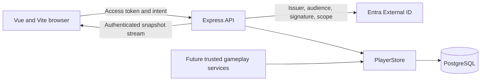

## Architecture



The repository uses npm workspaces: `apps/web`, `apps/api` and
`packages/contracts`. Shared Zod schemas validate wire and database projections.
No browser code can invoke trusted repository methods.

## Authentication

Local simulation exists only in the source development entrypoint. It requires
`NODE_ENV=development`, `LOCAL_AUTH_ENABLED=true`, a loopback database ending
in `_dev` without connection-string query overrides, and a loopback listener.
Local identities use their own issuer and namespace. They do not issue tokens,
and production JWT validation rejects their credential strings.

For real Entra sign-in during local development, set `LOCAL_AUTH_ENABLED=false`
and provide the existing Entra server settings through process environment.
The development API then uses the same JWT issuer, audience, JWKS-origin and
scope validation as hosted auth, while retaining the loopback listener and
dedicated `_dev` database restrictions. The default local simulated-player
mode is unchanged; this does not deploy or start a production instance. The
Vite dev server reads the SPA Entra settings from the repository-root `.env`.
Load `.env` as runtime configuration only and do not display or record its
values.

Production sign-in uses MSAL's authorization-code/PKCE redirect flow and API
access tokens. Set these server variables:

| Variable | Meaning |
|---|---|
| `NODE_ENV` | `production` |
| `DATABASE_URL` | Dedicated hosted PostgreSQL connection; use deployment-managed credentials and TLS |
| `ENTRA_ISSUER` | Exact API token issuer including tenant/version path |
| `ENTRA_AUDIENCE` | API application ID/audience, not the SPA client ID |
| `ENTRA_JWKS_URI` | Tenant JWKS URL on the pinned issuer origin |
| `ENTRA_SCOPE` | Required delegated scope name, for example `access_as_user` |
| `PORT` | API listener port, defaults to 3000 |

Set `VITE_ENTRA_AUTHORITY`, `VITE_ENTRA_CLIENT_ID` and `VITE_ENTRA_SCOPE`
before the browser build. The authority must include the tenant ID path and end
before `/v2.0`, for example
`https://YOUR-TENANT.ciamlogin.com/YOUR-TENANT-ID/`. Its
`v2.0/.well-known/openid-configuration` metadata must match the API issuer.
Vite reads the repository-root `.env` for development.
The browser development-auth constant is tied to Vite's `serve` command, not
`NODE_ENV`; all built artifacts exclude simulated credentials.

In the browser app registration's Authentication settings, add the
Single-page application platform and register `http://localhost:5173` there,
not under Web. Ensure `VITE_ENTRA_CLIENT_ID` identifies that browser app
registration, not the API registration. MSAL uses the browser's exact origin,
so do not substitute `127.0.0.1`.
If sign-in returns `AADSTS9002326`, check that this redirect URI has type
`spa`, remove any duplicate Web registration for that local URI, save, and
start a fresh sign-in. Do not add a client secret or enable implicit grants;
the browser uses authorization code with PKCE. The API can remain bound to
`127.0.0.1` because browser API requests use Vite's same-origin proxy.
See Microsoft's [SPA authorization-code guidance](https://learn.microsoft.com/en-us/entra/identity-platform/v2-oauth2-auth-code-flow#redirect-uris-for-single-page-apps-spas).
Register the production redirect/logout origins and the API's delegated
permission in the existing Entra external tenant. Configure its sign-in user
flow and consent, then verify actual tokens match the API issuer and audience. Real-tenant
configuration and successful live-tenant sign-in remain subject to the
interactive check recorded in the implementation evidence.

Production authentication never fetches key locations from token headers. The
API validates RS256 signatures, issuer, audience, subject, issued-at, expiration
and delegated scope against configured values. Identity uses issuer/subject,
never a supplied account ID, email or real name.

Run migrations from the repository root before starting the API:

```bash
npm run migrate
npm run build
NODE_ENV=production LOCAL_AUTH_ENABLED=false npm start
```

Build artifacts require the SQL migration directory at runtime for the migration
command. Run `npm run migrate` from the source release or
`node dist/apps/api/src/migrate.js` from a release containing that directory.
The application does not create hosted resources or validate the proposed
hosting budget. Configure HTTPS termination, database TLS, least-privilege
runtime/migration roles, connection limits and proxy streaming before hosting.

## HTTP surface

All private routes derive ownership from the verified identity. Query-string
account selectors are rejected. There is no arbitrary state or award write API.

| Method and route | Contract |
|---|---|
| `GET /api/config` | Public authentication mode only |
| `GET /api/snapshot` | Private account, matchmaking state, latest 50 completed battles, pending battle definitions, server time |
| `GET /api/battles/:id` | Stored replay, only for a participant; history beyond the snapshot remains retrievable by ID |
| `GET /api/events` | Bearer-authenticated fetch/SSE; initial snapshot, account or matchmaking revision updates and heartbeats |
| `POST /api/matchmaking/enqueue` | Enqueue the signed-in account at its expected matchmaking revision |
| `POST /api/matchmaking/cancel` | Cancel the signed-in account's queued state at its expected revision |
| `POST /api/matchmaking/accept` | Accept the current proposal ID at its expected matchmaking revision |
| `POST /api/matchmaking/decline` | Decline the current proposal ID at its expected matchmaking revision |
| `PATCH /api/profile` | Strict `transactionId`, `expectedRevision`, `displayName` intent |
| `DELETE /api/account` | Authenticated request with exactly `{"confirmation":"DELETE"}` |

Clients cannot supply levels, resources, completion times, combat decisions,
CPU inputs, damage, results or awards. Unknown fields fail with a visible error.
Stale profile or matchmaking actions and conflicting profile transaction-ID
reuse return HTTP 409. Authentication failures return 401/403; unavailable
durable state returns 503. Match proposals are created only by a trusted
server-side producer for two queued accounts; clients cannot choose opponents
or write lifecycle state directly. Queue selection policy, CPU fallback, and
combat are not implemented.

## Persistent contracts

`accounts` stores identity, environment namespace, a monotonic revision and a
validated account projection containing display name; all six animal levels,
residual XP, welfare and training dates; credits, turns and reset date;
completed facilities and pending purchases with cost/completion records.

`battle_reservations` stores immutable battle definitions, participants or CPU
profile, mode, locked statistics/bonuses, conditions, rule versions, seed and
daily reward reservation date. `reservation_accounts` provides relational
ownership and foreign keys.

`battles` stores the complete immutable replay, ordered events, outcome and
awards. `reward_counters` and `pair_reward_counters` persist daily reserved and
awarded capacity. `management_transactions` persists account-scoped
idempotency keys, intent fingerprints and results.

`matchmaking_state` stores each account's lifecycle status, independent
monotonic revision, current proposal ID, partner reference, acceptance, and
proposal deadline. Migration `002-matchmaking.sql` creates the table, backfills
existing accounts to `idle`, and cascades each account's own state on deletion.
Deleting one participant also cancels the other participant's linked proposal.

`PlayerStore.management` is a server-only callback under an account row lock.
It validates the resulting projection, atomically writes state/ledger/revision,
and returns the original result for an exact retry. The callback must be pure:
no outbound calls or effects outside the database transaction.

`reserveBattle` stores frozen server inputs and reserves account/pair reward
capacity under sorted participant locks. A retry reuses the same ID and seed.
`completeBattle` atomically stores the replay, applies trusted XP formulas to
the latest locked animal state, credits awards and moves reservation counters.
Concurrent completions cannot award twice. The caller supplies game rules and
limits; this layer does not implement combat, CPU decisions, leveling, daily
reset rules or facility pricing.

Reservation occurs when a battle is created, not when a transient matchup is
proposed. Future game services must process durable pending battles after a
restart using their stored seed/rules, independent of browser connections.
This scaffold does not yet include that simulation worker.

## Recovery

The browser uses bearer-authenticated fetch streaming, not tokens in SSE URLs.
The API reads the combined snapshot on the existing one-second poll cadence,
supporting separate API processes without an in-memory notification owner. It
sends an update when either account revision or matchmaking revision changes;
matchmaking-only transitions do not increment the account revision. The browser
reconnects after two seconds, always loading a new authoritative snapshot first,
and independently prevents stale account or matchmaking state from replacing
newer state. Obsolete sessions are aborted on sign-out.

Connections revalidate access tokens. Expiration or database failures visibly
interrupt the stream. While recovery fails, shown data is labeled potentially
stale and management or matchmaking controls are disabled. The browser never
stores progress or replaces missing server state with defaults. MSAL may store
identity session material, not gameplay progression.

The lifecycle supports `idle`, `queued`, `proposed`, `accepted`, `declined`,
`cancelled`, and `expired` states. Authenticated commands may enqueue, cancel,
accept, or decline only the signed-in account's current revision. A trusted
server-side producer proposes a match only for two queued accounts. The server
stores the 60-second acceptance deadline; snapshot recovery expires an overdue
proposal using database time and does not reset its deadline after restart.
This lifecycle does not implement the GDD's participant-selection policy,
CPU fallback, or combat.

## Deletion and privacy boundaries

An authenticated, explicitly confirmed deletion immediately removes the
application account and its progression/economy/management records. Linked
pending/completed battles, shared replay data and pair counters are removed,
too. The deleted account's matchmaking row is removed, and any linked
participant's open proposal is cancelled. Other participants keep their own
progress and aggregate daily counts; pending reward capacity is released and
their revisions advance.

A one-way issuer/subject fingerprint prevents an old signed-in identity from
silently recreating an erased account. The tombstone contains no raw issuer,
subject, account ID, name or gameplay history, but remains pseudonymous data.
Its retention and any future deliberate re-enrollment policy require privacy
review. This is not a claim of complete identity erasure.

Deleting application data does not delete the Microsoft identity or purge
backups. Before processing real beta accounts, define identity-provider
deletion responsibilities, tombstone retention, legal exceptions and backup
expiration/restore handling. Before public launch, review applicable regional
age, privacy and consent requirements. The intended 13+ audience is not legal
approval. No precise location or real name is required for gameplay.

## Observability and validation

HTTP errors emit sanitized structured logs with timestamp, OpenTelemetry
severity fields, safe message and a random request ID. Tokens, request bodies,
database URLs, player IDs and display names are not logged. HTTP and database
transaction spans use the OpenTelemetry API and semantic attributes.
A deployment may register a provider before startup; no exporter or external
telemetry destination is configured by this scaffold. Set `service.name`,
`service.version` and `deployment.environment` on that provider.

Validation covers runtime schemas, production exclusion, signed-token
cryptography with a local JWKS issuer, real PostgreSQL transactions/restart,
ownership, retry safety, rollback, reward reservations, deletion and Chromium
account/recovery flows. It does not establish real-tenant sign-in, gameplay
integration, hosted load/cost, cross-browser parity or privacy certification.

Issue #25 remains open; this lifecycle is the minimum #26 synchronization
boundary, not evidence that #25's full release acceptance criteria are met.
Broader #27 privacy, retention, backup and deletion-policy work is deferred
until backup policy exists. Hosted cost and SSE connection capacity are not
validated. Integrate and verify future queue, battle and management services
against this boundary.
